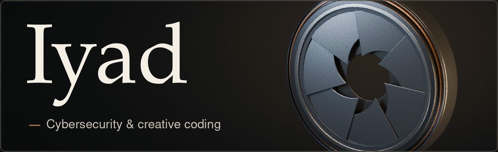

## Hi, I’m Iyad.

I’m a 16-year-old student from Algeria. I want to study cybersecurity because I’m curious about what happens when software is used in ways its developers didn’t expect.

### What I’m working on

- **Cybersecurity** · I’m learning how software and networks work, with a particular interest in web security.
- **AI & creative coding** · I use AI to build prototypes and experiment with motion graphics, including documentary scenes drawn and animated in code.
- **GRAVE** · I co-founded an Algerian menswear brand. I work on how we present our products and turn interest from our videos into orders.
